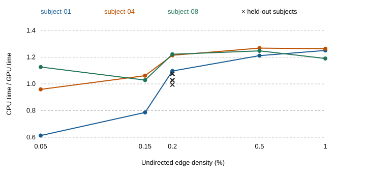

# M9 真实被试加权介数中心性与 GUI 后端选择

在本机 19,574 节点网络上，**0.5%、1%** 两档满足 GUI 自动优先 GPU 的建议余量。0.20% 档扩大到八名被试后，GPU 在 7/8 名上更快，适合留作本机校准档。速度结论只覆盖实测密度点，精确交叉位置随被试而变。

## 数据与计时

从历史验证的 8 名被试中，按已排序的网络文件取第 1、4、8 名。每人一次 500 时间点的静息态 fMRI，沿用 fMRIPrep、4 mm 重采样、混杂回归、0.01–0.08 Hz 滤波和组灰质掩模。1% 档直接使用归档的 PAGANI 2.2 Pearson 加权 CSR。其余档在原图的无向边中按权重降序取指定数目，边界同权时按端点编号升序，互反边一起保留。各档保留全部节点及原始浮点权重，图哈希保存在各自的 graph.json。[历史验证](VALIDATION_REPORT.md)

CPU 为 AMD Ryzen Threadripper 3970X 32-Core Processor，固定 32 线程。GPU 为 NVIDIA GeForce RTX 3080 Ti, 621.14, 12288 MiB。每个被试、每档密度独立启动两个 CLI 各两次，第二轮反转执行顺序。每次墙钟时间包含启动、CSR 读入、计算及输出。建网、错误比对和归档在计时外。设备处于通常的桌面运行状态。

## 配对结果

先对同一被试两轮时间取中位数，再跨被试取中位数。加速比为 CPU 耗时除以 GPU 耗时，范围表示三名被试的差异。显存列给出该密度六次 GPU 运行的最大值。整卡数据来自 NVML，每次查询后等待 25 ms，包含其他进程和驱动开销，可能漏过很短的峰值。算法缓冲区峰值来自程序内同时存活的 CUDA 分配总量。

| 密度 | CPU 秒 | GPU 秒 | 加速比中位数（范围） | GPU 胜出被试 | GPU 胜出配对 | 算法 MiB | 整卡 GiB |
|---:|---:|---:|---:|---:|---:|---:|---:|
| 0.05% | 2.14 | 2.11 | 0.96（0.61–1.13） | 1/3 | 2/6 | 265.25 | 9.87 |
| 0.15% | 6.37 | 6.19 | 1.03（0.79–1.06） | 2/3 | 4/6 | 269.64 | 10.30 |
| 0.2% | 8.22 | 6.73 | 1.21（1.10–1.22） | 3/3 | 6/6 | 271.83 | 9.10 |
| 0.5% | 21.95 | 17.59 | 1.25（1.21–1.27） | 3/3 | 6/6 | 284.98 | 9.09 |
| 1% | 54.12 | 43.27 | 1.25（1.19–1.26） | 3/3 | 6/6 | 306.90 | 9.02 |

共比较 782,960 个节点值（含重复运行）。最大绝对误差 0，CPU 非零节点上的最大相对误差 0。40/40 对输出文件的 SHA-256 完全相同。CPU 为零的节点以绝对误差验收，记录的相对误差为 NaN。

同一节点数下，0.15% 和 0.20% 的平均度分别约为 29.36 和 39.15。CUDA 实现在平均度达到 32 时切换高平均度内核。密度也同步改变孤立节点数和连通分量，因此本次对照无法单独估计内核切换的贡献。

## 0.20% 密度的留出被试验证

在其余五名被试上各做两次配对。GPU 在其中 4/5 名被试上更快，逐次获胜 9/10。合计八名被试，GPU 获胜 7/8，加速比范围 0.99–1.22。

| 留出被试序号 | CPU 秒 | GPU 秒 | 加速比 | 最大绝对误差 | 算法 MiB | 整卡 GiB |
|---|---:|---:|---:|---:|---:|---:|
| subject-02 | 7.34 | 7.14 | 1.03 | 0 | 271.83 | 8.83 |
| subject-03 | 7.64 | 7.10 | 1.08 | 0 | 271.83 | 8.82 |
| subject-05 | 7.10 | 6.92 | 1.03 | 0 | 271.83 | 8.83 |
| subject-06 | 5.32 | 4.95 | 1.08 | 0 | 271.83 | 8.84 |
| subject-07 | 5.71 | 5.75 | 0.99 | 0 | 271.83 | 8.83 |

纵轴 1.0 表示两种后端耗时相等。折线连接同一被试的五个实测点。叉号仅表示留出被试在 0.20% 的实测值。

## GUI 建议

1. 在加权介数旁提供「自动 / CPU / GPU」。保留用户手动选择，自动模式记录所选程序、选择原因、图规模和最终耗时。无权介数沿用已有调度。

2. 建议初始策略以同类图和同一硬件上的该档所有配对均至少快 10% 作为自动派发条件。满足 GPU 条件的密度点为 **0.5%、1%**，满足 CPU 条件的点为 **无**。10% 为耗时比的设计余量，用于减少微小波动导致的切换。初始校准仅适用于本机、19,574 节点、该版本程序和相似图结构。比较边数时允许阈值取整的一条边误差。

3. 为本机保存校准记录。匹配 CPU、线程数、GPU、驱动、算法版本、节点数、平均度和孤立节点比例。优先使用相近图的实测结果。接近交叉点、拓扑超出已测范围或更换硬件时，初次默认 CPU，可由用户启动一次配对测速，随后复用校准记录。密度不可作为跨节点规模的固定阈值。

4. 自动选择 GPU 前检测 CUDA 设备、可执行文件及可用显存。依内核的 CSR 固定分配和每批源点工作区估算容量。自动模式若遇到设备或资源错误，可重试一次 CPU，将本次成功输出原子替换到目标路径。数值或输入错误直接报告。强制 GPU 模式应显示具体失败原因。

5. 当前 Qt 在 mainwindow.cpp 和 pipeline.cpp 中禁用了加权介数。实施时同步更新 Settings/JSON、校验、预设与命令生成。加权 CLI 分别为 exefiles_weighted/CUBC 和 CUBC_GPU，现有命令按目录遍历全部 CSR，混合密度批次应增加单文件入口或按后端分组，确保每个网络只运行一次，成功后再交给 ConvertNII。

## 复核

项目内 tests/_work/m9_realdata/summary.json 保存各次耗时、误差、图结构、显存和设备信息。每个 subject-*/density-*/nodes-*.npz 包含从 0 开始的 CSR 节点序号、CPU 值、GPU 值和三种误差。对应的 .nm、程序日志和输入哈希均已保留。复跑使用 tests/realdata/m9_weighted_bc.py 的 --source、--package、--work 参数，输出到新目录。

留出被试原始文件位于 tests/_work/m9_realdata_holdout/。两组使用相同的目录结构和计时口径。
